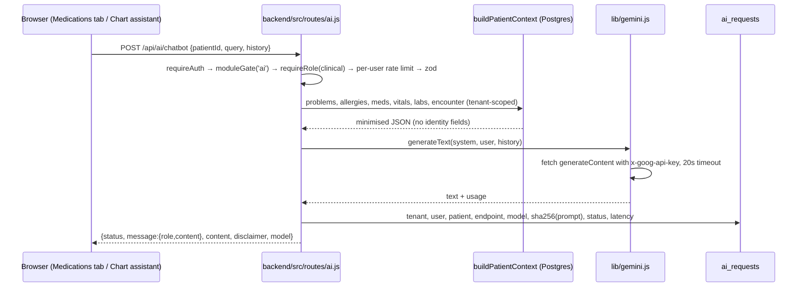

# AI Assistant Module: How It Works

## Configuration

| Variable | Default | Meaning |
|---|---|---|
| `GEMINI_API_KEY` | empty | Provider key. Empty → `isAiEnabled()` false → every AI route returns `503 AI_DISABLED` (status endpoint still works) |
| `GEMINI_MODEL` | `gemini-2.0-flash` | Model id used in the REST path |
| `GEMINI_TIMEOUT_MS` | `20000` | Abort timeout per call |
| `GEMINI_BASE_URL` | Google v1beta | Override for proxies |
| `AI_TEST_LIVE` | unset | Under `NODE_ENV=test` the provider is disabled unless this is `1` |

Tenant toggle: `tenants.enabled_modules` must contain `"ai"` (migration 022 added it everywhere; Super Admin can remove it).

## Endpoints

- `GET /api/ai/status` → `{ enabled, model, disclaimer }`. Any authenticated user in an `ai`-enabled tenant.
- `POST /api/ai/medication-explanation` → body: `brandName` or `genericName` plus optional `strength, route, type, description, doseInstruction, frequency, duration, quantity, refills, patientId`. Returns the `MedicationExplanation` shape the sidebar renders, plus `disclaimer` and `model`. JSON mode is requested from the provider and the response is normalised server-side.
- `POST /api/ai/chatbot` → body: `patientId` (required), `query`, optional `history[]` (`user`/`assistant`, max 20), `maxTokens`, `temperature`. Returns the reference contract (`message.role/content`, `content`).

Roles: physician, nurse, pharmacist (admin passes through `requireRole`'s existing bypass). Rate limit: 30/min per user in production, 300 in development, skipped in tests.

Error codes (`code` field): `AI_DISABLED` 503, `AI_RATE_LIMITED` 429, `AI_TIMEOUT` 504, `AI_UNREACHABLE` 502, `AI_PROVIDER_ERROR` 502, `AI_EMPTY` 502, `AI_BAD_JSON` 502.

## Patient context rules

`buildPatientContext` in `routes/ai.js` is the only place chart data enters a prompt. It includes: sex, age in years, current non-discharged encounter (type, admission diagnosis, admitted date, status), up to 25 problems, 25 active allergies, 40 active medications, latest value per vital type, last 30 lab results. It excludes names, MRN, DOB, addresses, phones, emails, insurance, documents and notes. The JSON is truncated at 12,000 characters. The test asserts that the patient's name, email and MRN never appear in the prompt.

## Audit

`ai_requests` rows are written on every call, success or failure, including when the provider is disabled. Columns: `tenant_id, user_id, patient_id, endpoint, model, prompt_sha256, status, error_code, latency_ms, prompt_tokens, output_tokens, created_at`. There is deliberately no prompt or response text column. The audit-log module should expose this table in the admin UI.

## Frontend

- `services/ai.service.ts`: `getAiStatus`, `explainMedication(parsed, patientId?)`, `askAboutPatient({patientId, query, history})`.
- Medications tab: clicking a medication name opens `MedicationAIExplanationSidebar`, which now shows the disclaimer in its header.
- `/app/ai-assistant?patientId=…`: staff chart assistant. The header sparkle button links here with the currently open chart's id. Without `patientId` the page asks the user to open a chart. The page checks `GET /api/ai/status` and shows a disabled/unavailable banner instead of a chat box when AI is off or the tenant module is disabled.
- `ChatInput`: Enter sends, Shift+Enter inserts a newline.

## Swapping the provider

Replace `generateText` in `lib/gemini.js` (keep the signature `{system, user, history, json, maxOutputTokens, temperature}` → `{text, model, usage}`) and the config block in `config.js`. Routes, tests and the frontend do not change. The test suite stubs the provider via `__setGeminiStubForTests`.
