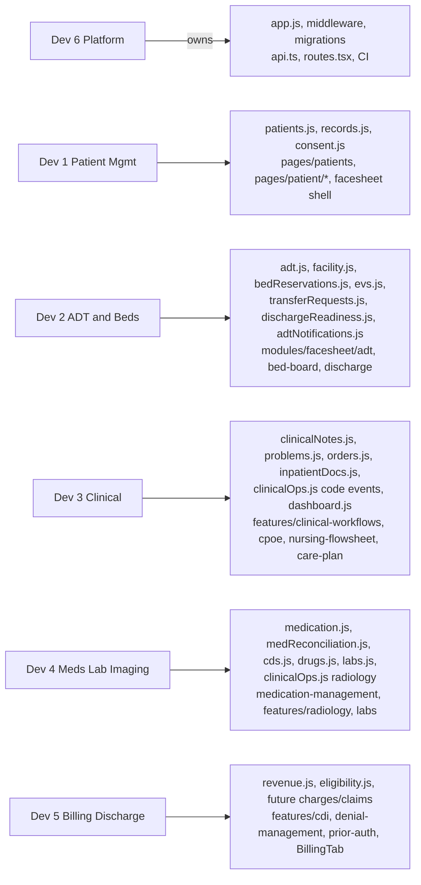

# Developer Task Distribution (Phase 8)

Audit date: 2026-11-12. Six workstreams, adapted to the actual codebase. Ownership is by backend router + frontend feature folder to avoid conflicting edits. Shared files (`app.js`, `middleware/*`, `services/api.ts`, `routes.tsx`, `facesheetModules.ts`, migrations) are owned by Developer 6 and changed only through that owner, with the requesting developer's module proposal referencing the cross-module impact.

All work items require a module change proposal and explicit approval before coding (see repository process rules).

## Ownership map

Shared-component conflict rule: `routes/clinicalOps.js` is split by concern (Dev 3 code events, Dev 4 radiology); `routes/adt.js` discharge handlers are Dev 2, discharge billing hooks are Dev 5 via Dev 2's proposal.

## Developer 1: Patient Management

| Field | Detail |
|---|---|
| Modules | Registration, Patient Details/facesheet shell, Search, History, Documents, Allergies, Immunizations, Consent |
| Existing status | Registration 65%, Details 60%, Search 80%, Documents backend-only, History read-only, Allergies 85% (1 failing test), Immunizations 35%, Consent 60% |
| Remaining | UI-01..UI-17; SEC-18; SAF-07 hide; registration USCDI fields; server required fields; unknown patient; deceased flag; merge (phase 2); registration-time consents; history/immunization write UI; document upload UI; BUG-01; BUG-06 |
| Frontend | `pages/patients/*`, `pages/patient/*`, `pages/facesheet/*`, `components/facesheet/*`, `components/patients/*`, `components/Layouts/FacesheetSidebar.tsx` (UI-01) |
| Backend | `routes/patients.js`, `routes/records.js`, `routes/consent.js` |
| API | New fields in `patientOut()`; required-field validation; `POST /Patient/registerUnknown`; consent without encounter |
| Database | `patients` columns (gender_identity, sex_at_birth, sexual_orientation, race_codes[], ethnicity_code, interpreter_needed, comm_prefs jsonb, deceased, deceased_at, is_unknown); `patient_contacts` role enum; `consents.encounter_id` nullable; `patient_documents` soft delete/version |
| Dependencies | Dev 6 for migrations, audit log, role matrix; Dev 2 for Location tab (SAF-08) |
| Acceptance | All 26 tabs render real or clearly-empty data at 1440/768/375 with no console errors; Playwright + axe pass; registration persists USCDI fields and FHIR Patient reflects them |
| Testing | Unit (validation), API (required fields, consents, documents), Playwright golden paths 1-2 |
| Complexity | High (UI breadth) |
| Definition of Done | Proposal approved; code + tests; docs updated; screenshots at 3 widths attached; no new mock data |

## Developer 2: Admission, Bed Management, Discharge

| Field | Detail |
|---|---|
| Modules | Admission, Transfers, Bed/Room/EVS, Discharge workflow, ADT notifications, Initial assessment checklist (data side) |
| Existing status | Beds 85%, Admission 55%, Transfers 60%, Discharge 55%, ADT notifications 65%, Assessments 10% |
| Remaining | SAF-08, SAF-14, SAF-20..22, SAF-24; admission code sets; admitting/attending FK + care team; visit number; observation; readmission; admission checklist; discharge order; disposition codes; AMA; deceased; pending-results/consent gates; client gate parity; recipient directory UI; departments; level of care |
| Frontend | `modules/facesheet/adt/*`, `modules/facesheet/location/*`, `pages/bed-board/*`, `modules/bed-board/*`, `pages/inpatient/DischargeReadinessPage.tsx`, `components/ipd/discharge/{DischargeSummaryTab,NursingChecklistTab,EligibilityTab}`, `components/adt/*`, `services/rooms.service.ts` placement removal, `dischargeReadinessValidation.ts` |
| Backend | `routes/adt.js`, `facility.js`, `bedReservations.js`, `evs.js`, `transferRequests.js`, `dischargeReadiness.js`, `adtNotifications.js`, `lib/bedManagement.js`, `lib/dischargeGates.js`, `lib/hl7Adt.js`, `lib/adtNotify.js` |
| API | Admission type/source enums; `care_team`; `POST /api/discharge-orders`; AMA + expired endpoints; disposition code validation; gate response contract |
| Database | `encounters` (admission_type enum extension, point_of_origin, admitting_physician_id FK, visit_number, patient_class, readmission_of), `encounter_care_team`, `departments`, `beds.level_of_care`, `discharge_orders`, `ama_discharges`, `death_records`, disposition code column |
| Dependencies | Dev 3 for H&P worklist and risk assessments; Dev 4 for med-rec gate; Dev 5 for billing gate; Dev 6 migrations |
| Acceptance | Admit → transfer → discharge golden path incl. AMA and expired; Location tab uses ADT; held bed admittable; UI gates equal server gates |
| Testing | Extend `api.test.js` ADT/bed/discharge scenarios; Playwright path 3 |
| Complexity | High |
| Definition of Done | As above plus HL7 DG1 segment validated against a test receiver |

## Developer 3: Clinical Documentation and Orders

| Field | Detail |
|---|---|
| Modules | Physician notes, Nursing notes/handoff, Nursing flowsheets, Risk assessments (persistence), Vitals, Problem list, CPOE ledger, Order dashboard, Care plans, I/O, Code events, Physician/Nursing dashboards |
| Existing status | Notes 70%, Nursing notes 0%, Flowsheets 60%, Assessments 15%, Vitals 50%, Problems 60%, CPOE 50%, Dashboard 45%, Care plans 50%, I/O 55%, Code events 75%, role dashboards 0% |
| Remaining | SAF-05, SAF-09, SAF-13, SAF-15, SAF-26, BUG-02/03/09/10/11/16; nursing notes + SBAR; server signatures; retained versions; co-sign; entered-in-error; worklists; POA/principal dx; vitals encounter link/thresholds/EWS; order types, hold/renew, acknowledgement, discontinue reason + sync (with Dev 4); remove mock fallbacks; role dashboards |
| Frontend | `pages/inpatient/ClinicalWorkflowsPage.tsx`, `features/clinical-workflows/*`, `features/nursing-flowsheet/*`, `features/cpoe/*`, `features/order-dashboard/*`, `features/care-plan/*`, `features/io-tracking/*`, `features/code-event/*`, `pages/patient/{Vitals,HealthTrends,Diagnoses,Notes,RiskAssessments}.tsx`, `pages/Dashboard.tsx` |
| Backend | `routes/clinicalNotes.js`, `problems.js`, `orders.js`, `inpatientDocs.js`, `patientData.js` (vitals), `clinicalOps.js` (code events), `dashboard.js`, `db/seedIcd10.js` |
| API | `/api/inpatient/clinical/nursing-notes`, `/handover`; `/api/risk-assessments`; `/api/orders/:id/{hold,renew,acknowledge}`; worklist endpoints; role dashboards |
| Database | `nursing_notes`, `handoffs`, `risk_assessments`, `health_metrics.encounter_id` + new metric types, `problems.poa`/`is_principal`, `clinical_notes` (cosign, prior content, status enum), `orders` (priority, reason, acknowledged_by), `nursing_flowsheets.chart_status` CHECK |
| Dependencies | Dev 4 for medication detail sync; Dev 6 for RBAC/audit; Dev 2 for admission checklist |
| Acceptance | Clinical Workspace fully real; nurse cannot sign as another user; H&P-missing worklist; order discontinue reflected in MAR |
| Testing | Split tests per module; Playwright path 6 |
| Complexity | High |
| Definition of Done | As above; clinical thresholds marked "requires clinical validation" in code and docs |

## Developer 4: Medication, Laboratory, Imaging

| Field | Detail |
|---|---|
| Modules | Medication orders, MAR, Med rec, e-Rx, Pharmacy, CDS, Drug DB, Labs, Results/critical notifications, Imaging |
| Existing status | Med orders 40%, MAR 15%, Med rec 70%, e-Rx 50%, Pharmacy verification 0%, CDS 45%, Drug DB 35%, Labs 65%, Results 40%, Imaging 50% |
| Remaining | SAF-02/03/04/06/16/17/18/19/23/25/27, SEC-11, BUG-13/15; MAR scheduler + statuses + BCMA-ready model; single write path; pharmacist verification; CDS coverage; RxNav live + code mapping; lab catalog; targeted critical routing + read-back + escalation; imaging safety, notification, ledger; mock fallback removal |
| Frontend | `pages/inpatient/medication-management/*`, `components/cds/*`, `pages/patient/{Medications,Prescriptions,Allergies,Labs,LabOrders,Radiology}.tsx`, `components/labs/*`, `features/radiology/*`, `components/ipd/IpdCriticalResultsStrip.tsx` |
| Backend | `routes/medication.js`, `medReconciliation.js`, `cds.js`, `drugs.js`, `labs.js`, `clinicalOps.js` (radiology), `lib/cds/*`, `lib/rxnav.js`, `lib/erx.js`, `lib/medRec.js`, `db/seedCds.js` |
| API | MAR schedule/give/hold/refuse/void; verification queue; `/api/lab-catalog`; notification routing; read-back; imaging critical |
| Database | `mar_entries` (status CHECK, reason, given_by FK, unique index, void fields), `medications` (unit, indication, start/stop, high_alert, schedule, status), `prescriptions.pharmacy_id` FK, `pharmacy_verifications`, `lab_tests` catalog, `lab_results` read-back columns, `critical_escalations`, `radiology_orders` safety columns |
| Dependencies | Dev 3 for orders ledger; Dev 6 for notification infrastructure; clinical reviewer for critical limits and CDS content |
| Acceptance | Fresh tenant: order → scheduled MAR → give; CDS on every path; critical lab notifies ordering provider only, with read-back; imaging critical visible on dashboard |
| Testing | MAR dedupe/status tests; CDS path coverage; labs routing; Playwright paths 4-5 |
| Complexity | Very high |
| Definition of Done | As above; no clinical rule content shipped without a "requires clinical validation" marker and reviewer sign-off |

## Developer 5: Billing, Insurance, Discharge Financials

| Field | Detail |
|---|---|
| Modules | Insurance, Eligibility, Prior auth, Charge capture, Coding, Claims, Statements, Denials, CDI, Stripe |
| Existing status | Insurance 50%, Eligibility 85%, Prior auth 10%, Charges/Coding/Claims/Statements 0%, Denials 55%, CDI 55%, Stripe 5% |
| Remaining | Phase 0: delete fabricated charges/claim submission, flip CDI/denial mock flags, remove dead Stripe patient checkout. Phase 1: billing role access to insurance, SEC-05 inbox gate, `GET /Eligibility/getById` gating, eligibility module gate. Phase 2/3: prior auth backend, chargemaster, charge capture, CPT/HCPCS/PCS/DRG, 837I, 835, statements, Stripe |
| Frontend | `features/cdi/*`, `features/denial-management/*`, `features/prior-auth/*`, `pages/billing/*`, `pages/patient/{Invoices,PriorAuth}.tsx`, `components/ipd/discharge/{BillingTab,ChargeCaptureTab}.tsx`, `pages/subscription/*`, `services/dischargeReadiness.service.ts` (charges section) |
| Backend | `routes/revenue.js`, `routes/eligibility.js`, future `routes/charges.js`, `claims.js`, `priorAuth.js`, `lib/stedi.js` |
| API | Charge CRUD; claim lifecycle; prior auth CRUD; statements |
| Database | `chargemaster`, `charges`, `claims`, `claim_lines`, `remittances`, `payments`, `prior_authorizations`, FK from `claim_denials` to `claims`, typed money columns |
| Dependencies | Dev 2 discharge hooks; Dev 3 problem list POA/principal; Dev 4 medication/lab charge events; licensing decisions (CPT) |
| Acceptance | No fabricated financial data anywhere; denial/CDI UIs on real backend; charge capture persists; 837I validates against a clearinghouse test |
| Testing | API tests per endpoint; Playwright discharge billing tab |
| Complexity | High (Phase 3 very high) |
| Definition of Done | As above; money stored as NUMERIC with constraints |

## Developer 6: Platform and Infrastructure

| Field | Detail |
|---|---|
| Modules | Auth, RBAC, Audit logging, Security hardening, Notifications, Shared API client, Router, CI/CD, Migrations, Staff/hospital management, Staff scheduling UI flag, Interop (FHIR/SMART/HL7 transport), AI remediation |
| Existing status | Auth 50%, RBAC 45%, Audit 5%, Security 45%, Notifications 40%, Staff 55%, Scheduling backend-only, FHIR 50%, SMART 60%, CI 0% |
| Remaining | SEC-01..04, SEC-06..09, SEC-12..17, SEC-19..22; audit log; read RBAC matrix + frontend guards; MFA; session; CI; test split; notification producers + polling/SSE; departments; credentials; scheduling flag; FHIR paging/discovery/`aud`/profiles; HL7 TLS; remove dead code (`api/`, orphaned pages) after approval |
| Frontend | `services/api.ts`, `services/auth*.ts`, `store/authSlice.tsx`, `components/auth/*`, `router/routes.tsx`, `components/Layouts/*` (nav/role), `pages/platform/*`, `modules/settings/*`, `pages/staff-scheduling/*`, `services/geminiApi.ts` (delete) |
| Backend | `app.js`, `config.js`, `middleware/*`, `routes/auth.js`, `platformAdmin.js`, `platformAuth.js`, `tenantProfile.js`, `staffing.js`, `smartAuth.js`, `fhir.js`, `patientAccounts.js`, `lib/fhir/*`, `lib/adtTransport.js`, `lib/email.js`, `db/migrate.js`, `.github/workflows/*` |
| API | `/api/audit-events`; MFA endpoints; role matrix; notifications stream |
| Database | `audit_events`, `user_mfa`, `login_attempts`, `token_denylist`, `departments`, `staff_credentials`, `fhir_access_log.tenant_id` nullable, encrypted secret columns |
| Dependencies | Everyone depends on this stream; sequence 1.1 → 1.2 → 1.3 first |
| Acceptance | CI green on every PR; every PHI read audited; MFA enforced; role matrix tests; no secrets in repo (gitleaks) |
| Testing | Table-driven 401/403 tests; audit assertions; security scan in CI |
| Complexity | High |
| Definition of Done | As above; security items re-verified by an independent reviewer |

## Sequencing and conflict avoidance

1. Week 1: Dev 6 Phase 0 + CI; Dev 1 UI-01 and tab hiding; Dev 5 fabricated-data removal; Dev 3/4 mock fallback removal in their folders.
2. Weeks 2-4: Dev 6 auth/audit/RBAC (blocks others' role work); Dev 1 registration/details; Dev 2 bed fixes + admission model; Dev 3 nursing notes + signatures; Dev 4 single medication path + MAR scheduler; Dev 5 billing-role fixes.
3. Weeks 5-8: cross-module items (admission checklist, discharge gates, critical routing) once RBAC and audit land.
4. Migrations: one numbered file per approved module change, authored by the module developer, reviewed and applied by Dev 6 to avoid numbering collisions (precedent: migration 009 renumbering).
5. `facesheetModules.ts` and `routes.tsx` changes are batched weekly by Dev 6 from each developer's proposal.
