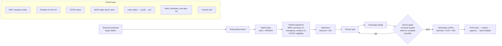
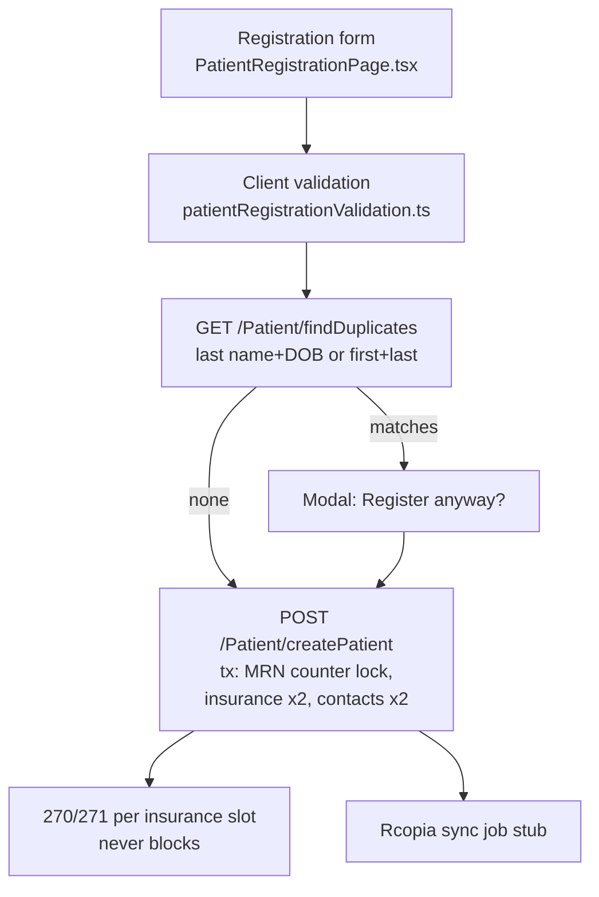
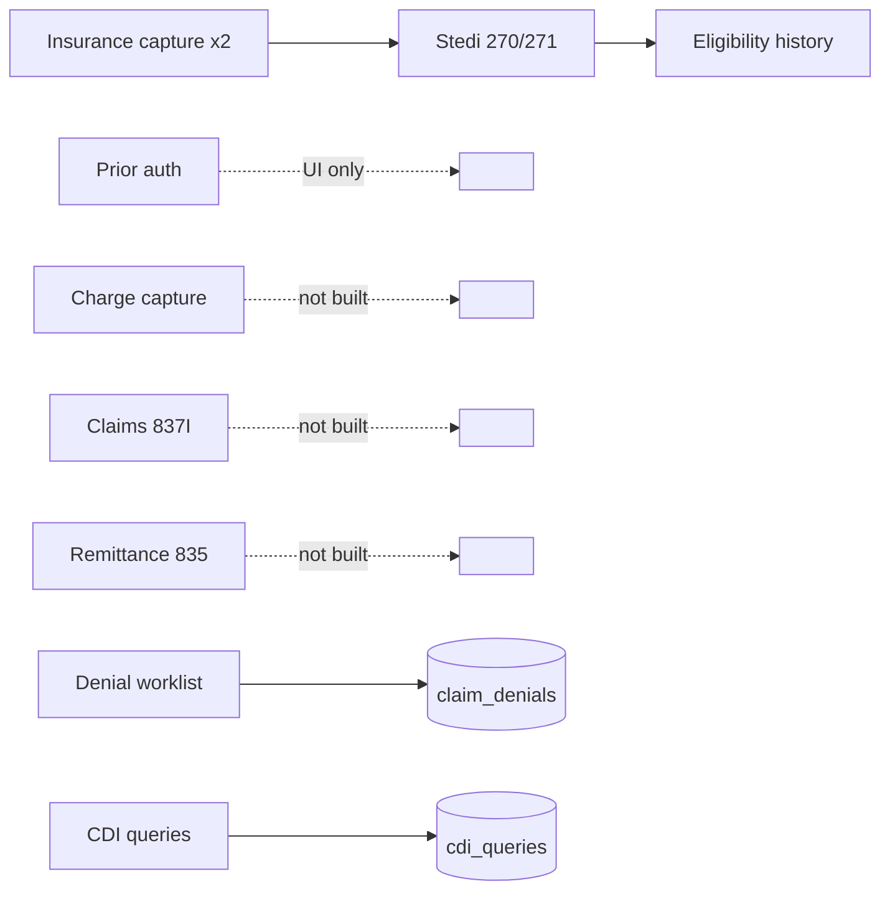
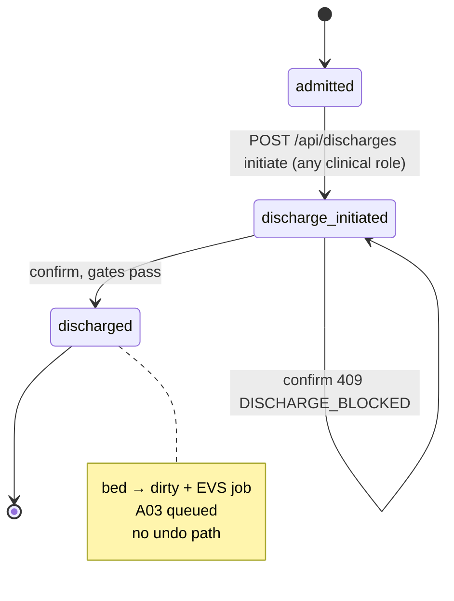

# Inpatient Workflow Audit

Audit date: 2026-11-12. Each stage below states what the code actually does today, followed by the gap against a standard US inpatient workflow. Clinical protocols are not invented here; absent capabilities are simply named.

## 0. End-to-end flow as implemented

Legend of what is **not** in this flow because it does not exist: admission assessments, nursing notes, verbal orders, pharmacy verification, scheduled MAR, charge capture, claims, AMA/deceased workflows, C-CDA at discharge.

## A. Hospital and staff management

| Capability | Status | Evidence |
|---|---|---|
| Hospital (tenant) setup, status, plan, modules | Done | `platformAdmin.js`, migrations 004/005/009 |
| Departments and units | Partial | No `departments` table; wards act as units |
| Staff registration by role (admin, physician, nurse, pharmacist, billing, staff) | Done | `auth.js:293-362`, admin-only |
| Receptionist / lab staff / housekeeper roles | Missing | Only 6 flat roles; EVS reuses `staff`/`nurse` |
| Credentials and licenses | Minimal | NPI (Luhn) + DEA regex only; no license number, state, expiry, privileging |
| Role-based permissions | Partial | Mutations gated; reads mostly open; admin bypasses clinical gates |
| Activation / deactivation | Done, lagging | `is_active` honoured at login/refresh, not per request (up to 15 min) |
| Password management | Weak | min 8 chars; no complexity/history/lockout; forgot-password sends no email in prod |
| MFA | Missing | No code |
| Audit history | Missing | No staff audit log |

## B. Patient registration

Field coverage against the required set:

| Requirement | Present | Notes |
|---|---|---|
| Legal name (prefix/first/middle/last/suffix) | Yes | |
| DOB, sex | Yes | Backend only requires first+last; API callers can omit DOB/sex |
| Gender identity, sex at birth, sexual orientation (USCDI v3) | No | |
| Race / ethnicity | Labels only | Single free-text value, no OMB/CDC codes, no multi-select |
| Address (home + mailing) | Yes | 5-digit ZIP only, no validation/standardisation |
| Contact (4 phones, 2 emails) | Yes | |
| Emergency contact | Yes (max 2) | |
| Next of kin / legal guardian / authorised rep | No distinct role | `family_contacts` separate and unreconciled |
| Preferred language | Yes (string) | No ISO code, no interpreter-needed flag |
| Communication preferences | No | |
| MRN | Yes | Per-tenant race-safe counter, caller-supplied allowed |
| Insurance | Yes (primary + secondary) | No tertiary, no subscriber demographics, no COB |
| Guarantor | Yes | Per-coverage fields |
| PCP | Yes | Name + NPI + notification recipient |
| Consent records | Not at registration | `consents.encounter_id NOT NULL`; only NPP date on patient |
| Identity verification | No | |
| Emergency / unknown patient ("John Doe") | No path | |
| Patient merge | No | |
| Deceased flag / date | No | |
| SSN | Not stored | Acceptable minimisation; no SSN-based matching either |
| Photo | Yes | data URL in DB |
| Advance directive | Text status only | No document, no code status |

## C. Patient admission

| Requirement | Status | Evidence |
|---|---|---|
| Emergency / direct / scheduled / observation / transfer-in | 3 types only: `emergency, elective, urgent` | `adt.js:58` |
| Admission source | Free text | No UB-04 point-of-origin codes |
| Admitting vs attending physician, care team | Attending only, unvalidated text id | `adt.js:60`, no FK |
| Admission diagnosis | Free text | Not linked to ICD-10 problem list |
| Bed assignment | Done, 3-layer conflict prevention | partial unique index + `FOR UPDATE` + `assertBedFree` |
| Initial physician assessment (H&P within 24h) | Note type exists; 24h flag reported, not enforced; no missing-H&P worklist | `clinicalNotes.js:31-38` |
| Initial nursing assessment | Missing | No artifact |
| Medical / surgical history | Read-only in UI | create/delete routes have no UI caller |
| Allergies | Done | Full CRUD, FHIR-aligned fields |
| Medication reconciliation (admission) | Endpoint exists, not prompted at admission | `medReconciliation.js` |
| Vital signs | Patient-level only, no encounter link | `health_metrics` |
| Risk assessments (fall, Braden, GCS, pain) | UI only; saves silently discarded | `RiskAssessments.tsx` to dead `/api/RiskAssessment/*` |
| Consent and acknowledgement | Exists per encounter, not prompted or gated | `consent.js` |
| Visit/account number, readmission detection | Missing | |

## D. Clinical management

| Area | Status | Key gaps |
|---|---|---|
| Physician dashboard | Missing | Single shared dashboard |
| Nursing dashboard | Missing | No assignment worklist |
| Patient clinical overview (facesheet) | Partial | 26 tabs; 4 mock, 1 dead, 6 hidden; header lacks allergy/code-status banner |
| Physician progress notes / H&P | Done | No co-sign, no templates, checksum-only version history |
| Nursing notes | Missing | Routes declared in UI only |
| Vital signs | Partial | No thresholds, no EWS, no pain/BMI, RR+height disabled in form |
| Diagnosis / problem list | Partial | ICD-10 catalog empty out of the box (download script is Windows-only); no POA, principal dx, SNOMED |
| Medication management | Partial | Three write paths, CDS only on CPOE path |
| Medication reconciliation | Done | No physician attestation, lines uncoded |
| MAR | Minimal | No scheduled doses; "Give" button unreachable on real data |
| Lab orders and results | Done (basic) | See `application-audit.md` |
| Imaging | Partial | Orders/results; mock fallback |
| Procedures | Missing | No ICD-10-PCS |
| Clinical orders (CPOE) | Partial | 4 types; discontinue does not deactivate the medication |
| Care plans | Partial | 10-row NANDA seed, mock fallback on |
| Nursing assessments / flowsheets | Flowsheet done with forgeable signature | |
| Patient monitoring | Missing | No EWS, no vitals alerts |
| Critical result notifications | Labs only | Broadcast to all clinicians, no escalation |
| Consultations | Note type only | No consult order/workflow |
| Discharge planning | Checklist tasks | No expected discharge date, barriers |

## E. Bed and facility management

Bed placement is the strongest subsystem. Double assignment is impossible at the DB level (`encounters_active_bed_uq`). Holds, EVS turnaround, transfer requests, isolation and mixed-sex advisories all work and are tested.

Gaps: no departments; no level of care on beds; `rooms.service.ts` shadow placement path writes to `localStorage` and bypasses ADT; held beds cannot be chosen in the admit dropdown (`emrBeds.service.ts:109-120` filters `held` but backend uses `hold`); admin `available` override skips inspection.

## F. Billing and insurance

Only eligibility, denials and CDI have backends; the denial/CDI UIs run on mock stores by default. The discharge workspace fabricates $12,260 of charges and a random payer claim id in the browser.

## G. Discharge

| Requirement | Status |
|---|---|
| Discharge readiness view | Done (`/api/encounters/:id/discharge-readiness`) |
| Physician approval / discharge order | Missing; any clinical role initiates and confirms |
| Discharge summary | Done; 8 sections, ICD-10 required, physician sign, immutable |
| Discharge med rec | Done; hard gate |
| Follow-up instructions, education, referrals | Free text / checklist labels only |
| Pending results gate | Missing |
| Discharge prescriptions | Done (meds handoff + e-Rx) |
| Final billing | Missing (returns `available:false`) |
| Bed release | Done via EVS |
| Disposition codes | Free text; no UB-04 status codes |
| AMA workflow | Missing (dropdown label only) |
| Deceased workflow | Missing (dropdown label only) |
| Transfer-out to other facility | Label only; no C-CDA |
| Client/server gate mismatch | UI blocks on mock charges/prior auth/eligibility; omits server med-rec gate |
