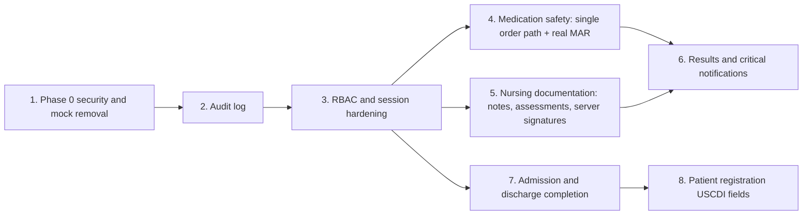

# Next Modules: Recommended Order and Plan

Date: 2026-11-12. Patient Details is complete (see `patient-details/01-completed-work.md`). This document proposes what to implement next, in order, with a plan for each. Every item still requires its own change proposal and approval before code is touched.

## Status snapshot

| Module | Status after today |
|---|---|
| Patient Details (facesheet) | Completed for the approved scope; residual items listed in its completion report |
| Everything else | As in `module-inventory.md` |

## Recommended order

Rationale: items 1 to 3 remove credential exposure, give the system a legal record of access, and make role boundaries real; nothing clinical should be expanded before that. Items 4 to 6 are the patient-safety core (medication, nursing record, critical results). Items 7 and 8 complete the ADT and demographic data model the earlier modules depend on.

## 1. Phase 0 bundle (split into per-module approvals)

| Sub-module | Work | Effort |
|---|---|---|
| AI assistant | **Done 2026-11-12** (see `ai-assistant/01-completed-work.md`): server-side proxy, audit, role gate, minimised context. Remaining for you: new Gemini key in `backend/.env`, BAA decision, optional history purge | done |
| Auth | **Done 2026-11-12** — password log removed, `/auth/register` gated by `ALLOW_SELF_SERVICE_REGISTRATION` | done |
| Eligibility | **Done 2026-11-12** — PHI-free 270/271 log summary, sanitised error details | done |
| Frontend platform | **Done 2026-11-12** — see `frontend-platform/01-completed-work.md` | done |
| Discharge workspace | **Done 2026-11-12** — see `discharge-workspace/01-completed-work.md` | done |
| Dashboard | **Done 2026-11-12** — mock prior-auth strip removed | done |
| CI | **Done 2026-11-12** — see `ci/01-completed-work.md`; runs on next push | done |

**Phase 0 is complete** (only the Gemini key replacement remains on your side). The next module is the audit log.

## 2. Audit logging (platform)

- Table `audit_events` (id, tenant_id, user_id, role, patient_id, encounter_id, action, resource, resource_id, route, method, status, ip, user_agent, at, details jsonb) with no UPDATE/DELETE grants.
- Middleware after `requireAuth`: log every request touching a patient or encounter (derived from route params and known body fields) plus login/logout/failed login, user CRUD, role changes, exports, platform actions (tenant create/suspend/delete, module changes).
- Make `fhir_access_log.tenant_id` nullable so 401s are logged.
- `GET /api/audit-events` (admin, filters by patient/user/date) and a Settings → Audit Trail page.
- Tests: every chart read produces a row; tenant delete logged; cross-tenant query returns nothing.

## 3. RBAC and session hardening (platform)

- Read-side role matrix table in `middleware/auth.js`; apply to notes, labs, documents, prescriptions, MAR, ADT log, CDI inbox, order dashboard, dashboard.
- Separate `admin` from clinical privileges (admin cannot sign, prescribe, dispense, acknowledge criticals).
- New roles: lab_tech, radiologist, housekeeper, case_manager, receptionist.
- MFA (TOTP) with enrolment and recovery codes; lockout after N failures; NIST 800-63B password rules; idle timeout; access-token denylist on logout; per-request `is_active`/role check.
- Frontend: route guards by role; nav items hidden by role.
- Tests: table-driven 401/403 matrix.

## 4. Medication safety foundation (Dev 4)

- Retire `POST /api/patients/:id/medications` and `POST /api/prn-stat` as order paths (or make them call the CPOE path) so CDS and RxNorm apply everywhere.
- Medication order fields: unit, indication, start/stop, high-alert flag, controlled schedule, status enum, discontinue reason; discontinue propagates ledger ↔ detail row in one transaction.
- MAR: schedule generator from frequency (Q4H, BID, TID, QID, daily, custom), `mar_entries` status CHECK (`due, given, held, refused, not_given, late, voided`) with reason codes, `given_by = req.user.id`, unique index per (medication, scheduled_time), void/amend endpoint, overdue computation; role gate on reads.
- CDS: persist `blocked` outcome; enforce allergy class enum server-side; `RXNAV_MODE=live` default in production with SCD/SBD → IN mapping.
- Med rec: RxNorm typeahead on lines; prescriber attestation step.
- Tests for each of the above; clinical reviewer sign-off for frequency tables.

## 5. Nursing documentation (Dev 3)

- Tables and routes for `nursing_notes` and `handoffs` (SBAR), matching the endpoints the Clinical Workspace already calls.
- `risk_assessments` table and routes for Braden, Morse, GCS, pain, nutrition; wire the existing `RiskAssessments.tsx` UI.
- Nursing admission assessment artifact linked to the encounter.
- Flowsheet: signer and timestamp from `req.user`; `amended` treated as locked; persist `shiftInfo`; UI locks only after server confirms.
- Overdue-documentation worklists (H&P missing, unsigned notes) and a nursing dashboard.

## 6. Results and critical notifications (Dev 4)

- Route critical lab notifications to the ordering provider, attending and assigned nurse only; message without name/MRN (link instead).
- Read-back fields on acknowledgement (who called, who received, time, read-back verified).
- Escalation job for unacknowledged criticals with tenant-configurable timers.
- Imaging: critical finding notification; result/cancel closes the CPOE ledger row.
- Re-notify on corrections that remain critical.
- Patient-portal release policy for lab Observations (clinical and legal review required).

## 7. Admission and discharge completion (Dev 2)

- Admission type/source code sets; admitting physician and care team with FKs; visit number; observation status; readmission flag; admission checklist (allergies, med rec, vitals, risk screens, consent, H&P deadline).
- Discharge order with physician approval; UB-04 disposition codes; AMA workflow (refusal form, witness, signature); deceased workflow (time, pronouncing physician); pending-results and consent gates.
- Recipient directory UI for ADT notifications; HL7 DG1 segment; MSH-10 length fix.

## 8. Patient registration USCDI fields (Dev 1)

- Gender identity, sex at birth, sexual orientation, coded race/ethnicity (multi-select), interpreter needed, communication preferences, next-of-kin/guardian roles, deceased flag/date, unknown-patient path, registration-time consents (make `consents.encounter_id` nullable).
- Server-side required fields; list filter bugs (`19-35`, recency, name sort).
- FHIR Patient extensions for the new fields.

## After these

Pharmacy verification and BCMA, order sets and verbal orders, procedures/ICD-10-PCS, reporting (census, LOS, readmissions), charge capture and claims, LIS/PACS interfaces, C-CDA/Direct, FHIR (g)(10) conformance. See `phase-1-roadmap.md` for the full phase plan and `third-party-integrations-by-module.md` for what each needs externally.

## How to start the next module

Reply with the module name. The next step is a detailed analysis of that module followed by a Module Change Proposal in the agreed format; no code is changed until the proposal is approved.
