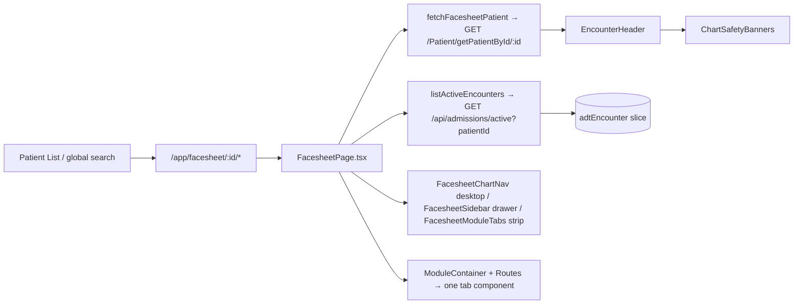
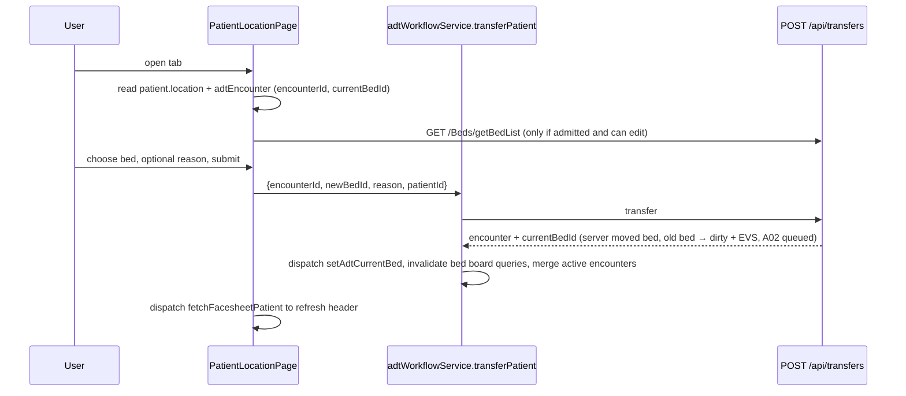

# Patient Details Module: How It Works

Audience: developers and reviewers picking up the chart (facesheet) after the 2026-11-12 changes.

## 1. Entry and layout

- `FacesheetPage` loads the patient into Redux (`facesheetSlice`) and merges the active encounter into `adtEncounterSlice`. Modules are **not rendered until the patient resolves**; a failure shows a retry panel.
- The header shows name, status, MRN, sex, DOB, language, bed, I/O badge, and the ADT action buttons. Under it, `ChartSafetyBanners` shows active allergies and isolation.
- Navigation is defined once in `src/facesheet/facesheetModules.ts` (`FACESHEET_MODULES`) and rendered by three components: desktop rail, mobile drawer (`FacesheetSidebar`, 260px), mobile tab strip.

## 2. Module list and gating

`FACESHEET_PREVIEW_MODULE_PATHS` = `dietary`, `prior-auth`, `invoices`, `preventive-screening`. These have no server module. `isFacesheetModuleEnabled(path)` returns `false` for them unless `VITE_FACESHEET_PREVIEW_TABS=true`, which removes them from both navigation and `<Routes>` so a direct URL falls through to the Demographics redirect.

Every other module is real and visible: Demographics, Vitals, Location, ADT, History, Diagnoses, Medications, Prescriptions, Allergies, Immunizations, Nursing Flowsheet, Care Plan, Infection Control, Orders, Labs, Lab Orders, Radiology, Documents, Consents, Notes, Visitors & Contacts.

## 3. Mobile drawer CSS

The theme stylesheet positions `.sidebar` for the 200px main menu (`.horizontal .sidebar { left: -200px }` etc.). The chart drawer is 260px, so `tailwind.css` now has explicit `.sidebar.facesheet-chart-nav` rules for every layout mode: `-260px` closed, `0` when the body has `toggle-sidebar`. If the drawer width changes, update both the component class and these rules.

## 4. Location tab

Rules: not admitted → message + link to the ADT tab (admission assigns the first bed); no edit role → read-only; discharge initiated → transfers disabled. `PlacementWarningsBanner` runs the server placement check for the chosen bed (isolation, mixed-sex, holds). Errors from the server are shown inline under the form, not only as toasts.

The former `patientLocation.service.ts` / `rooms.service.ts` placement store (localStorage + in-memory map) is gone; `rooms.service.ts` now returns server bed state unmodified.

## 5. Safety banners

`ChartSafetyBanners` (`components/facesheet/ChartSafetyBanners.tsx`):
- Allergies: `GET /Patient/getAllAllergyList?rcopiaID=<patientId>`; rows with `status === false` are skipped; shows up to four allergens with severity, "+N more" after that.
- Isolation: `GET /api/HAIEvent/encounter/<encounterId>` directly (not through the mock-default HAI service). Latest event per infection type decides; `infection_resolved` or status `resolved` clears it; `isolation_started` or any `isolationType` marks active.
- On fetch failure the badge renders "unknown" so missing data is never read as "no allergies".
- Both queries are React Query with a 30s stale time; keys `['chart-safety', 'allergies', patientId]` and `['chart-safety', 'isolation', encounterId]`. Invalidate those keys after allergy or HAI writes if instant refresh is required.

## 6. Dialogs

`hooks/useDialogA11y.ts` gives any panel: Escape → `onClose`, initial focus, Tab/Shift+Tab trap, focus restore to the opener. `components/shared/DialogShell.tsx` wraps legacy hand-rolled modals with that hook plus `role="dialog"`, `aria-modal`, `aria-labelledby` and an overlay close button; callers keep their own panel markup and pass the title id to their heading via the render-prop `({ titleId }) => ...`. `AppModal` uses the same hook, so new modals should use `AppModal`; `DialogShell` exists only to retrofit old ones.

## 7. Error and empty states

`components/facesheet/ModuleErrorState.tsx` renders a red panel with the message and a Retry button. List tabs set `loadError` in their fetch `catch` and render `loadError ? <ModuleErrorState/> : loading ? spinner : list`. Empty state text is unchanged ("No record found."). Pattern to follow for any tab that still uses toast-only errors.

## 8. Things to know

- Patient data is still fetched independently per tab (no shared cache beyond the header); see the architecture doc for the planned normalisation.
- The Medications tab still mounts the Gemini sidebar (security finding SEC-01); it is out of this module's scope.
- `useCanEditPatientLocation` is a client-side role hint only; the server enforces transfer permissions.
- Tests: `tsc` strict and vitest cover the pure helpers; there are no component tests yet. The browser checks performed are listed in `01-completed-work.md`.
