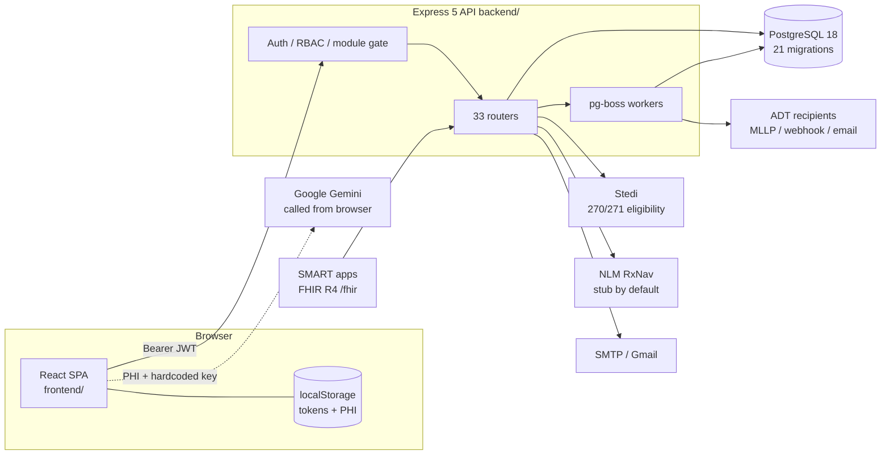
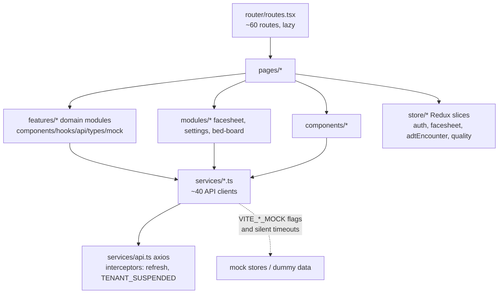

# Technical Architecture

Audit date: 2026-11-12. Codebase at commit `ae3173f` (branch `main`). Read-only audit; no application code was modified.

## 1. Repository layout

| Path | Role | Status |
|---|---|---|
| `frontend/` | Vite + React 18 + TypeScript 5.6 (strict) SPA, Tailwind, Redux Toolkit + Zustand + TanStack Query, react-router v6 | Active. ~560 `.tsx` + ~250 `.ts` files, ~102k lines |
| `backend/` | Node 20+ ESM, Express 5, raw `pg` (no ORM), zod, JWT, pg-boss job queue | Active. 33 route files, 21 SQL migrations, ~12.6k lines |
| `api/` | Legacy Mongoose/MongoDB CarePlan microservice | **Dead code.** Not imported anywhere; superseded by Postgres tables. Should be deleted in a future cleanup (needs approval) |
| `.cursor/plans/` | 18 build plans written during development | Reference only; several are now stale relative to code |
| `MODULE_COMPLETION_REPORT.txt`, `PHASE1_DEMO_READY_MODULES.txt` | Earlier status reports (2026-10-30 / 11-02) | Superseded by this audit |

## 2. System context

The dashed edge is a security defect, not a design: `frontend/src/services/geminiApi.ts` sends medication and lab data directly from the browser to Google with a git-tracked API key. See `issues-and-fixes.md` SEC-01.

## 3. Backend design

### 3.1 Request pipeline (`backend/src/app.js`)

1. `helmet`, strict CORS allowlist, `express.json({limit:'2mb'})`, global rate limit (600 req/min/IP, disabled under `NODE_ENV=test`).
2. Public: `/health`, `/health/db`, `publicAuthRouter` (login, refresh, forgot/reset, **open tenant self-registration**), platform login, SMART/patient-portal auth, FHIR (`/fhir`, each route gated by `requireSmartAuth`).
3. `authRouter` (self-gating), then `requireAuth` (tenant JWT, re-reads `tenants.status`/`enabled_modules` per request), then `requireModuleGate` (static path-prefix to module table).
4. 28 protected routers mounted at `/`.

Known ordering trap: routers mounted at `/` with a blanket `router.use(middleware)` intercept all later routers. Never add such a router; apply middleware per route.

### 3.2 Three credential spaces

| Space | Secret | TTL | Notes |
|---|---|---|---|
| Staff | `JWT_SECRET` (15m access, 7d rotating refresh hashed in DB) | 15m / 7d | `typ:'access'` verified |
| Platform admin | `PLATFORM_JWT_SECRET`, **derived from `JWT_SECRET` if unset** | 30m | separate login |
| SMART / patient | `SMART_JWT_SECRET`, **derived from `JWT_SECRET` if unset** | 15m | grant re-read from DB each request |

### 3.3 Data layer

- Every clinical table carries `tenant_id` with `ON DELETE CASCADE`; IDs are text UUIDs.
- Multi-step writes use `withTx` + `SELECT ... FOR UPDATE` (bed placement, orders, prescriptions, denials).
- Parameterised SQL throughout; no injection found. Sort/filter columns go through whitelists.
- Files (documents, consent signatures, profile photos) are stored **inside Postgres** as `BYTEA` or base64 data URLs. No object storage.
- No `departments` table: `wards` double as units/departments.
- Several JSONB-heavy tables (`care_plans`, `io_records`, `nursing_flowsheets`, `hai_events`, `claim_denials`, `cdi_queries`) have `patient_id`/`encounter_id` as plain TEXT without FKs.

### 3.4 Migrations (21)

| # | Content |
|---|---|
| 001 | tenants, users, refresh tokens, wards/rooms/beds, patients, encounters, bed_transfers, visitors/family, health_metrics, nanda, care_plans, io_records, consents, nursing_flowsheets, medications, mar_entries, prn_stat, prescriptions, dispenses, discharge_medications, cdi_queries, claim_denials, hai_events |
| 002 | notifications |
| 003 | appointments, service locations, patient_documents, allergies, immunizations, history, lab_orders/documents, staffing, radiology_orders, code_events |
| 004-005 | platform_admins, tenant status/plan/modules |
| 006 | CPOE `orders` ledger |
| 007 | bed_reservations, evs_queue, transfer_requests, room isolation |
| 008 | patient registration fields, patient_insurance, emergency contacts |
| 009 | tenant_profile |
| 010 | mrn_counters |
| 011 | eligibility_checks |
| 012 | icd10_codes, problems |
| 013 | clinical_notes |
| 014 | discharge_summaries, discharge_checklist_tasks |
| 015 | medication_reconciliations, medications.source |
| 016 | e-prescribing columns, pharmacies, users.npi/dea |
| 017 | lab_results |
| 018 | notification_recipients, adt_notification_log, patient PCP |
| 019 | drug_interaction_rules, cds_severity_overrides, cds_alerts |
| 020 | patient_accounts, smart_clients, smart_authorizations, fhir_access_log |
| 021 | allergy clinical fields |

### 3.5 Background jobs (pg-boss)

`adtNotification` (HL7 delivery with retry), `bedReservationExpiry` (1-minute cron), `rcopiaSync` (console stub).

## 4. Frontend design

### 4.1 Mock-flag inventory (critical finding)

Thirteen `VITE_*_MOCK` style flags exist. `frontend/.env` sets only `VITE_UNIFIED_ORDERS_MOCK=false` and `VITE_USE_MOCK_API=true`. Every other flag defaults to **mock on**, so the shipped UI silently bypasses working backends:

| Flag | Default | Effect when unset |
|---|---|---|
| `VITE_CARE_PLAN_MOCK` | on | 4.5s timeout then in-memory care plan |
| `VITE_IO_MOCK` | on | 5s timeout then mock I/O |
| `VITE_CODE_EVENT_MOCK` | on | 5s timeout then **fabricated code-blue timeline** |
| `VITE_HAI_EVENT_MOCK` | on | mock infection events |
| `VITE_RADIOLOGY_MOCK` | on | mock on API error |
| `VITE_CDI_DENIAL_MOCK` | on | CDI + denial worklists on mock stores although backend is complete |
| `VITE_STAFF_SCHEDULING_MOCK`, `VITE_STAFFING_API_MOCK` | on | scheduling UI on fixtures although backend is complete |
| `VITE_CHARGE_CAPTURE_MOCK` | on | fabricated charges/claims in discharge workspace |
| `VITE_QUALITY_MEASURE_MOCK` | on | no backend exists |
| `VITE_MEDICATION_API_MOCK` | off | opt-in only |
| `VITE_UNIFIED_ORDERS_MOCK` | **off** (set in .env) | real |

Pure mock with no backend at all: prior auth, dietary, allied-health notes, invoices, quality measures, risk assessments, triage, daily log, health alerts, chronic dashboard, preventive screening.

### 4.2 Patient data flow

Backend has one shared shaper (`patientOut()` in `routes/patients.js`) for every patient read. The frontend has **no shared patient cache**: the facesheet header (Redux `facesheetSlice`), Demographics tab, Patient List, ADT search and appointment booking each fetch and map independently with loosely typed records (`[key: string]: unknown`, status sniffed across ~8 aliases).

### 4.3 Session storage

Access token, 7-day refresh token, `user`, `role`, and a cached `patientData` object are persisted in `localStorage`. Nursing flowsheet drafts (full PHI) are also written to `localStorage`.

## 5. Build, test, CI

| Check | Result on 2026-11-12 |
|---|---|
| `frontend: tsc --noEmit` | clean (exit 0) |
| `frontend: vitest run` | 27/27 pass (5 pure-module files) |
| `backend: node --test` (5 files) | **46/47 pass**; `patient records` test fails at `tests/api.test.js:570` (allergy status shape after migration 021) |
| CI | **None.** No `.github/workflows`. `npm test` glob in backend is broken on Linux shells; run files by path |
| Component/browser tests | None |

The backend integration suite requires the embedded Postgres (`npm run db:embedded`, port 5544) which was not running at audit start; migrations 019-021 were also unapplied on the dev DB and were applied to run the suite.

## 6. Environments and secrets

- `backend/.env` is gitignored; `config.js` hard-requires `JWT_SECRET`, `JWT_REFRESH_SECRET`, `DATABASE_URL` (no insecure defaults).
- Stedi sandbox key, Gmail SMTP credentials present locally only.
- `frontend/src/services/geminiApi.ts:5` contains a **hardcoded, git-tracked Google API key** fallback.
- `frontend/src/services/auth-tokens.ts:7` and `store/authSlice.tsx:12` hardcode a fallback API origin `https://devapi.mdcareproviders.com`.
- No TLS to Postgres, no encryption at rest, SMTP `rejectUnauthorized:false`, webhook secrets stored plaintext.

## 7. External integrations

| Integration | State |
|---|---|
| Stedi eligibility 270/271 + payer search | Real (sandbox), disabled without key |
| HL7 v2 ADT A01/A02/A03 outbound | Real builder; MLLP, HTTPS webhook, email transports; `direct` throws |
| FHIR R4 + SMART App Launch (PKCE) | Real, 8 resources, patient compartment, access log |
| RxNav drug search | Stub (14 drugs) unless `RXNAV_MODE=live` |
| e-Rx transmission (Surescripts) | Stub, fail-closed |
| Stripe (tenant subscription) | Stub; patient-side checkout targets nonexistent endpoints |
| Rcopia | Stub |
| Gemini AI | Browser-side, unsafe |
| LIS (ORU), PACS, PDMP, Direct, C-CDA, 837/835 | Not implemented |

## 8. Architectural risks to address before production

1. Browser-side third-party AI with PHI and a leaked key.
2. No staff-side audit log (only `fhir_access_log` for the patient API).
3. Read-side RBAC essentially absent (116/127 GET routes auth-only).
4. Mock fallbacks on live clinical screens with no visual indicator.
5. Forgeable signatures: MAR `given_by` and nursing flowsheet `signedBy`/`signedAt` come from the request body.
6. Shadow bed-placement path in `rooms.service.ts` writing to `localStorage` instead of ADT.
7. Three separate medication write paths, only one of which runs CDS.
8. No CI, one failing backend test, no frontend component tests.
