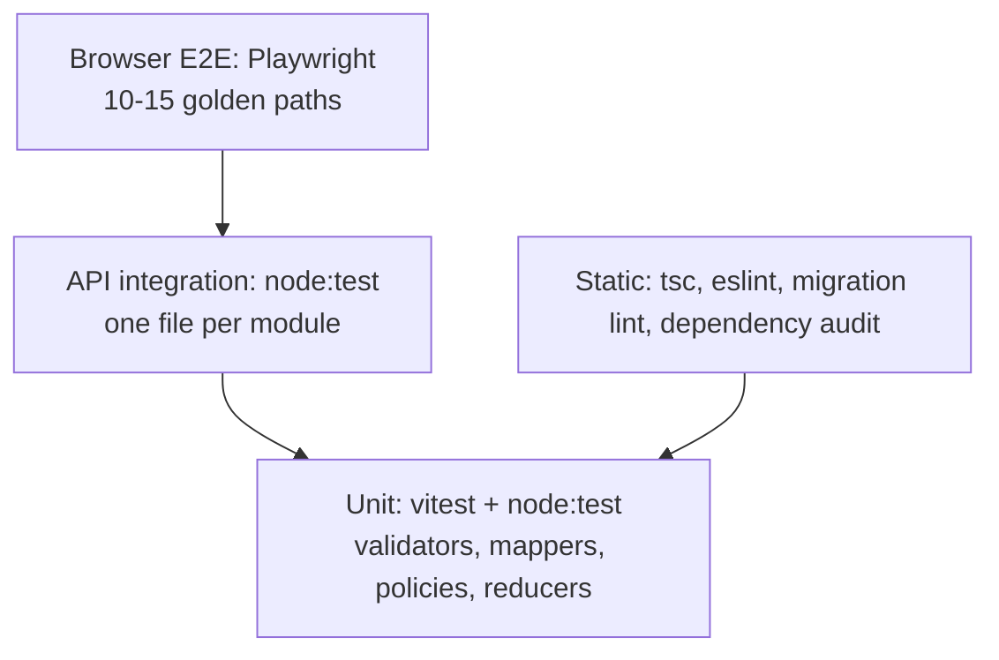

# Testing Strategy

Audit date: 2026-11-12.

## 1. Current state

| Layer | Exists | Observations |
|---|---|---|
| Backend integration | `backend/tests/api.test.js` (2,302 lines, 32 scenario tests, node:test, sequential) | High-value end-to-end scenarios per module against a live Postgres. 1 failing (`:570`). Requires embedded DB on 5544 and `NODE_ENV=test`; `npm test` glob broken on Linux shells |
| Backend unit | `cds.unit.test.js`, `contracts.test.js`, `eligibilityMapper.test.js`, `seedIcd10Parse.test.js` (15 tests) | Good targets: mappers, policy, parsers |
| Frontend unit | vitest, 5 files, 27 tests (pure modules only) | No component, hook, or router tests |
| Browser / E2E | none | Audit found 20+ defects only visible in the browser |
| CI | none | No `.github/workflows`; no lint gate; `tsc` only via `npm run build` |
| Accessibility | none | |
| Security | none | |
| Load | none | |

Seed data is synthetic (`db/seed.js`, `seedOps.js`); keep it that way. Never use real patient data in tests.

## 2. Target pyramid

## 3. Immediate actions (platform module, needs approval)

1. Fix `npm test` script: `node --test --test-concurrency=1 tests/*.test.js` (or pass files explicitly).
2. GitHub Actions workflow: Postgres service container → `db:migrate` → backend tests → `tsc --noEmit` → vitest → `vite build`. Fail on the existing red test until BUG-01 is resolved.
3. Split `api.test.js` into per-module files sharing a `tests/helpers.js` (tenant factory, login, `call`). Keep sequential execution.
4. Add `eslint` with `@typescript-eslint` and `react-hooks` rules as a CI gate.
5. Add `npm audit --audit-level=high` to CI.

## 4. Per-module testing requirements (used as Definition of Done)

| Module | Unit | API integration | UI / E2E | Regression |
|---|---|---|---|---|
| Auth / RBAC | password policy, lockout counter, jti denylist | 401/403 matrix per role per route (table-driven); deactivated user rejected within one request; MFA enrol/verify | login, MFA, idle logout | existing tests :64-:107, :380 |
| Audit log | event schema | every PHI read writes a row; privileged actions logged; 401 on FHIR logged | audit viewer renders | none yet |
| Patient registration | validation module (exists) | required-field enforcement server-side; unknown-patient path; merge | register + duplicate modal + eligibility | :1247, :1442 |
| Patient details | module resolver, mappers | per-tab endpoint contract tests | Playwright: every tab at 1440/768/375, no console errors, no overflow, header visible, axe pass | this audit's walkthrough |
| ADT / beds | bed picker enum | hold→admit; AMA/deceased dispositions; disposition code validation | admit → transfer → discharge golden path | :107, :1063, :1762 |
| Discharge | gate evaluation | server/client gate parity; pending-results gate | finalize with blocked and clear states | :1762 |
| Clinical notes | template schemas | co-sign; entered-in-error; prior content retained; overdue H&P worklist | sign flow | :1651 |
| Nursing docs | flowsheet reducer | signer = `req.user`; amended locked; `shiftInfo` round-trip; nursing notes CRUD | sign chart, confirm server state | :290 |
| Medication / MAR | frequency → schedule generator, reason codes | due generation; duplicate administration rejected; held/refused reasons; discontinue syncs detail row; CDS on every write path | MAR give/hold flows | :313, :1711, :1836, :2056 |
| Labs / results | critical-limit evaluator | targeted notifications; read-back fields; escalation job; correction re-notify; release policy | enter result → ack | :1910 |
| Imaging | mappers | ledger closure; critical notification; safety fields required | order → result | :744 |
| Billing | 837 builders, pricing | charge capture CRUD; claim lifecycle | discharge billing tab on real data | :313, :1490 |
| Interop | HL7 builder (DG1, MSH-10, escaping), FHIR bundles (paging/total) | `.well-known` at FHIR base; `aud`; `$export` | SMART app launch E2E | :1987, :2170 |
| Notifications | — | producers per event; targeting | bell updates without reload | :392 |

## 5. Browser E2E golden paths (Playwright, seeded tenant)

1. Login → dashboard → patient list → open chart → all 26 tabs load without console errors (desktop, tablet, mobile).
2. Register patient with duplicate warning → eligibility result shown.
3. Admit with bed hold → transfer → discharge blocked → complete gates → confirm → EVS to available.
4. Place medication order with CDS override → MAR scheduled → give → hold with reason.
5. Lab order → collect → critical result → targeted notification → acknowledge with read-back.
6. Sign H&P → addendum; nurse cannot sign.
7. Role matrix: billing user cannot open chart tabs that are restricted.
8. Patient portal: invite → set password → SMART authorize → FHIR read.

## 6. Non-functional

- Accessibility: axe-core in Playwright on each golden path; keyboard-only pass of modals.
- Security: OWASP ZAP baseline in CI against the dev server; dependency audit; secret scanning (gitleaks) to catch SEC-01 recurrences.
- Performance: k6 smoke on patient list, bed board, orders dashboard at 50 concurrent users; watch the `LIMIT 2000` dashboard query.
- Data: migration up/down smoke on a copy of production-shaped synthetic data; verify every `tenant_id` FK cascade before each release.

## 7. Test data policy

- Only synthetic patients (MRN000001-7 seed set plus factories).
- No production dumps in any environment.
- AI prompts in tests must use fixtures, never fetched PHI.
